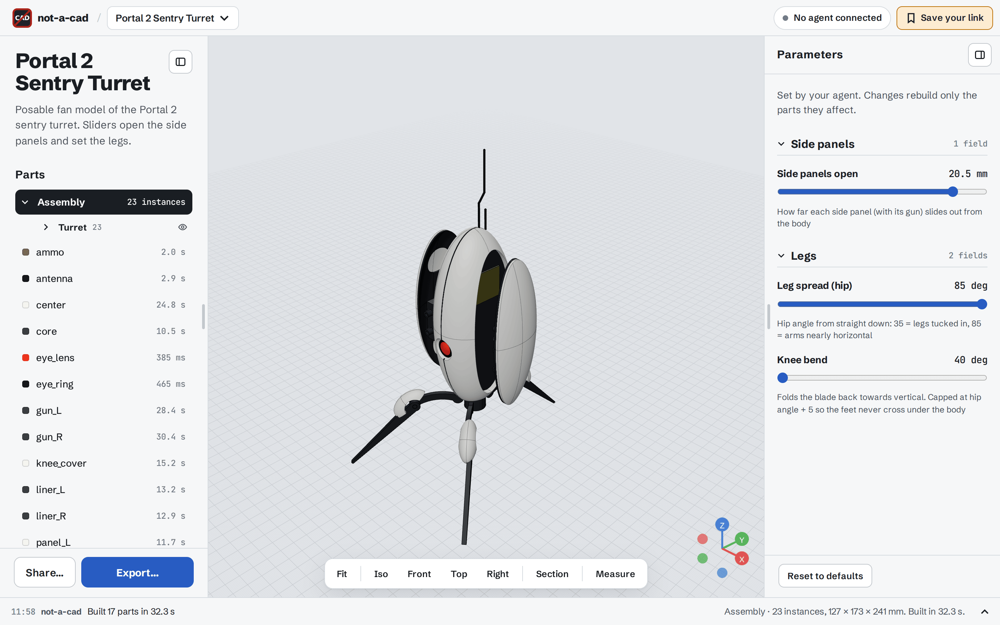
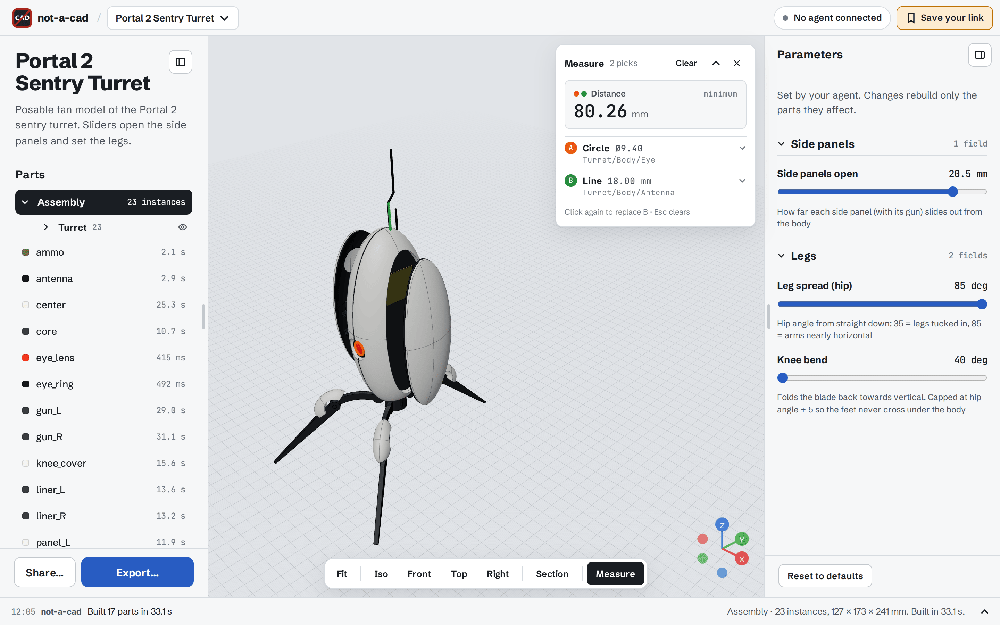
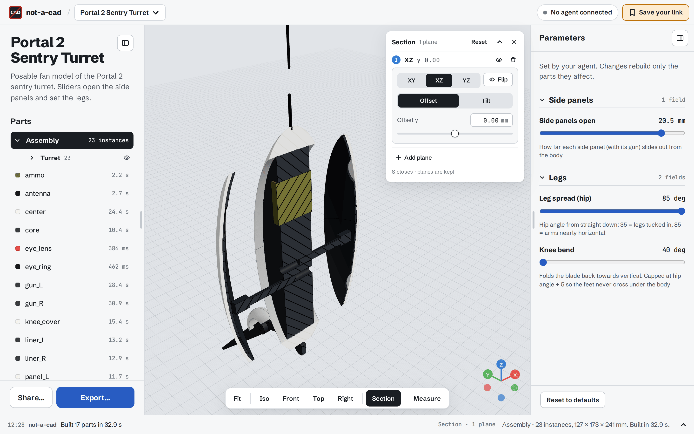
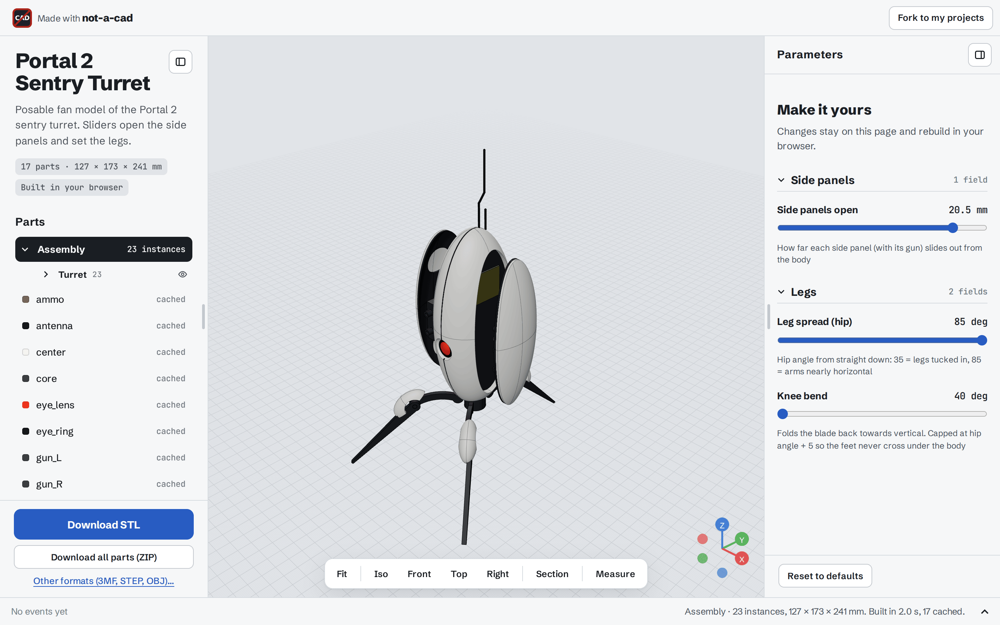
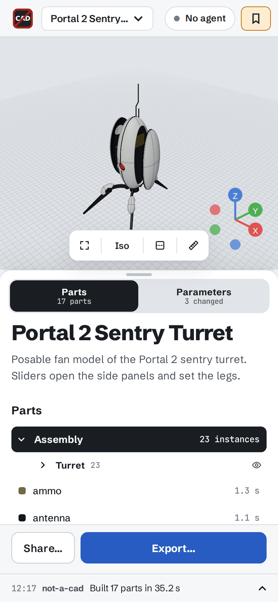

# not-a-cad

**A CAD you don't draw in.** Your AI agent (Claude Code, Cursor, Claude Desktop, or any MCP client) builds parametric solid models over [MCP](https://modelcontextprotocol.io). You watch them appear in your browser, tweak the parameters the agent exposes, measure, cut sections, export STL / 3MF / STEP / OBJ, and share a link anyone can open and remix.

All geometry runs in the browser: [OpenCascade](https://dev.opencascade.org) compiled to WebAssembly, through [replicad](https://replicad.xyz). The server is a small relay that stores projects and passes agent tool calls to your open tab.



| Exact measurements | Section view |
|---|---|
|  |  |
| **Public share viewer** | **Phone** |
|  |  |

## Features

- **Agent-driven modelling.** About 30 MCP tools: primitives, booleans, fillets, part scripts (replicad JavaScript), assemblies and assembly scripts, parameters, screenshots, exact measurements, exports and projects. Built-in design guides cover modelling, assemblies, 3D printing, DFM and standard parts.
- **Parametric models.** The agent defines a form (numbers with units, sliders, checkboxes, radios, selects, text). You edit the values, and only the affected parts rebuild, live.
- **Assemblies.** Placed instances with colours, groups, and scripted assemblies (counts, angles, poses) driven by parameters.
- **Measure.** Click faces, edges, vertices or section lines to get exact B-rep values: lengths, distances, angles, diameters, fillet radii, areas and sizes. Agents get the same facts with `inspect_part` and `measure`.
- **CAD-style navigation.** Zoom goes to the cursor in proportion to the scroll (trackpad pinch too), and orbit and pan pivot on the point under the cursor.
- **Section view.** Up to three cutting planes with offset, tilt and hatched caps. Measurements follow the cut.
- **Exports.** STL, 3MF (parts and colours), STEP (exact geometry) and OBJ, for single parts, the assembly in place, or both.
- **Sharing.** Publish a snapshot at `/s/<id>`. Visitors build it in their own browser, change parameters (kept in the link), export, or fork it into their own projects. Share pages carry Open Graph previews.
- **Fast rebuilds.** A pool of kernel workers builds in dependency order. Meshes and exact shapes are cached in IndexedDB, so reopening a project builds nothing.
- **Projects and workspaces.** No accounts: a workspace link opens your project library from any browser. Agents connect with OAuth, and you approve each one once.
- **Works on phones.** Collapsible panel sheet, touch-sized controls.

## Quick start

### Docker Compose (PostgreSQL)

```sh
curl -O https://raw.githubusercontent.com/baranov-org/not-a-cad/main/compose.yaml
curl -o .env https://raw.githubusercontent.com/baranov-org/not-a-cad/main/.env.example
# set POSTGRES_PASSWORD in .env, then
docker compose up -d
```

Open http://localhost:8787.

### Single container (embedded database)

```sh
docker run -d -p 8787:8787 -v not-a-cad:/data ghcr.io/baranov-org/not-a-cad:latest
```

With no `DATABASE_URL`, the server keeps its data in an embedded PostgreSQL ([PGlite](https://pglite.dev)) under `/data`.

### Kubernetes (Helm)

```sh
helm install not-a-cad ./chart -n not-a-cad --create-namespace \
  --set ingress.enabled=true --set ingress.className=nginx --set ingress.host=cad.example.com \
  --set ingress.tls.enabled=true --set ingress.tls.clusterIssuer=letsencrypt
```

The database is one of three modes (`database.mode`):
- `embedded` (default, no dependencies);
- `cnpg`: a [CloudNativePG](https://cloudnative-pg.io) cluster created by the chart;
- `external`: `DATABASE_URL` from `database.existingSecret`.

See [`chart/values.yaml`](chart/values.yaml) for storage, network policy, limits and resources. The pod runs as non-root with a read-only root filesystem and no service-account token. It's a single replica, because browser sockets live in one process.

## Connect an agent

1. Open your instance and keep the tab open. `/` opens your workspace: a library of projects, remembered by this browser. *Save your link* (top bar) shows the workspace link that opens it anywhere.
2. Add the MCP endpoint `<your origin>/mcp` to your agent. The agent pill in the top bar shows the exact URL.
   - **Claude Code:** `claude mcp add --transport http not-a-cad https://cad.example.com/mcp`
   - **Other clients:** add a remote MCP server (Streamable HTTP) with that URL. The client must support MCP OAuth (Claude Code, Claude Desktop and Cursor do).
3. On first connect the agent opens an approval page. Click **Allow** to bind it to your workspace. Approvals last until you revoke them under *Connected agents*.
4. Ask for something: *"Make a parametric wall shelf bracket with two M5 screw holes, and expose depth and thickness."*

The agent works on the project open in your tab. Every tool call is listed in the console at the bottom of the page.

## Configuration

All settings are optional environment variables:

| Variable | Default | Meaning |
|---|---|---|
| `PORT`, `HOST` | `8787`, `0.0.0.0` | Listen address |
| `DATABASE_URL` | unset | PostgreSQL URL; unset uses embedded PGlite in `DATA_DIR/pglite` |
| `DATA_DIR` | `/data` in the image | Embedded database and mesh bundle cache |
| `PUBLIC_URL` | unset | Public origin, e.g. `https://cad.example.com`. Used for OAuth metadata, links given to agents and share pages. Unset: taken from `X-Forwarded-Proto/Host`, else the request |
| `AUTH_REQUEST_TTL_MS` | `120000` | How long an agent approval request waits |
| `MAX_SESSIONS` | `2000` | Workspaces stored |
| `MAX_SESSION_BYTES` | `1000000` | Model sources per workspace |
| `MAX_TOTAL_BYTES` | `200000000` | Model sources of all workspaces |
| `MAX_BUNDLE_BYTES` | `524288000` | Share mesh bundle cache on disk |
| `MAX_CONNECTIONS`, `MAX_CONNECTIONS_PER_IP` | `300`, `10` | Open browser sockets |
| `MCP_PER_MINUTE`, `WS_PER_MINUTE`, `OAUTH_PER_MINUTE` | `240`, `30`, `60` | Per-IP rate limits |

Build-time: `VITE_ASSETS_BASE` (Docker build arg) serves the 22 MB kernel WASM from a CDN instead of the app. By default it's served by the app itself.

### Behind a reverse proxy

- Forward WebSocket upgrades (`/ws/…`) and allow long reads (an hour). Agent tool calls can take minutes.
- Allow request bodies of at least 40 MB: publishing uploads the share's meshes (up to 32 MB).
- Set `PUBLIC_URL`, or forward `X-Forwarded-Proto` and `X-Forwarded-Host`.
- Per-IP limits read `CF-Connecting-IP`, then `X-Forwarded-For`. Put the app behind a proxy that sets these, so clients can't choose their own IP.

## Development

```sh
pnpm install
pnpm dev                    # server :8787 + Vite :5173
pnpm lint
pnpm test                   # unit tests (shared, server with in-process PGlite, web kernel with real OpenCascade)
pnpm build && pnpm test:e2e # Playwright: browser + MCP client; starts a postgres container (needs Docker)
```

### Architecture

- `shared/`: protocol types, MCP tool schemas.
- `server/`: Fastify.
  - `/mcp`: MCP endpoint (bearer auth);
  - `/oauth/*`: OAuth 2.1 authorization server (PKCE, dynamic client registration, rotating refresh tokens; only token hashes are stored);
  - `/ws/:workspace`: the browser socket that relays tool calls to the open tab;
  - `/api/…`: projects library and shares;
  - storage: PostgreSQL or PGlite.
- `web/`: React and three.js viewer, plus a pool of kernel Web Workers (replicad / OpenCascade) that build parts, mesh them, measure and export.
- `chart/`: Helm chart. `compose.yaml`: Docker Compose.

Builds happen in the browser that has the project open. The server never runs model code.

## Credits

- [replicad](https://replicad.xyz) and [OpenCascade](https://dev.opencascade.org) (via replicad-opencascadejs): the CAD kernel.
- [three.js](https://threejs.org), [React Three Fiber](https://r3f.docs.pmnd.rs) and [drei](https://github.com/pmndrs/drei): the viewer.
- [text-to-cad](https://github.com/earthtojake/text-to-cad) (MIT): the agent design guides are adapted from its skills. See [`server/src/guides.NOTICE.md`](server/src/guides.NOTICE.md).
- [Model Context Protocol](https://modelcontextprotocol.io) TypeScript SDK, [Fastify](https://fastify.dev), [PGlite](https://pglite.dev).

## License

[MIT](LICENSE)
